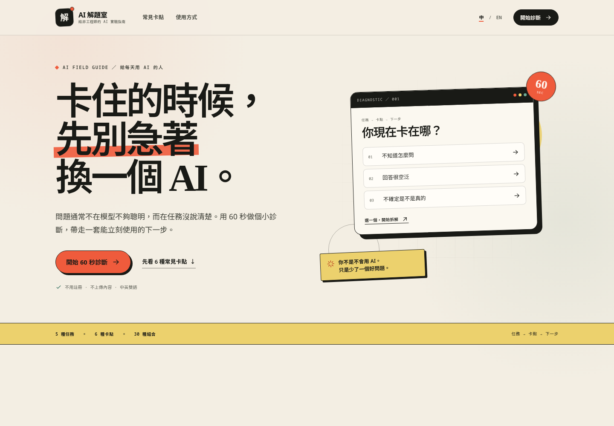

# AI 解題室 · AI Unstuck

> 卡住的時候，先別急著換一個 AI。

一個給非工程師的中英文 AI 實戰指南。用三個步驟定位「任務 × 卡點」，產出一份可以立刻照做的診斷：3 個具體動作、一段可複製的提示詞，以及最容易踩的雷。



## 這是什麼

很多 AI 卡關不是因為模型不夠聰明，而是因為任務沒有說清楚。這個網站不提供另一份「100 個神奇 prompt」清單，而是幫使用者把問題拆開：

- **引導式診斷**：選擇任務 → 選擇卡點 → 選填情境，30 種結果組合。
- **可執行的結果頁**：3 步行動、可複製的客製化提示詞、避免事項與下一步。
- **中英雙語**：所有介面與指南內容都有繁體中文與英文版本，可隨時切換。
- **可分享**：分享連結只包含任務與卡點，不會帶上使用者填寫的文字。
- **完全靜態**：沒有後端、沒有 API 金鑰、沒有追蹤腳本；輸入只留在瀏覽器。
- **可直接列印**：結果頁提供列印／存成 PDF 的版面。
- **無障礙**：鍵盤操作、可見焦點、語意標記、降低動態效果支援；以 axe WCAG 2.2 AA 規則檢查為 0 violations。

### 五種任務 × 六種卡點

| 任務 | 卡點 |
| --- | --- |
| 寫作與溝通 | 不知道怎麼問 |
| 整理與摘要 | 回答很空泛 |
| 學習與理解 | 怕它亂編 |
| 規劃與決策 | 格式一直不對 |
| 資料與表格 | 來回卡住 |
|  | 不敢貼資料 |

## 技術架構

- [Vite](https://vite.dev/) + [React](https://react.dev/) + TypeScript
- 純 CSS 設計系統，沒有 UI framework 或外部字型請求
- 使用 hash routing，GitHub Pages 不需要 SPA fallback
- `base: './'`，可部署在帳號根目錄、專案子路徑或自訂網域
- 狀態保存：語言存在 `localStorage`；本次診斷草稿存在 `sessionStorage`，關閉分頁即清除

```text
src/
├── App.tsx                 # 路由、語言、草稿狀態
├── components/
│   ├── Chrome.tsx          # Header、Footer、品牌標記
│   └── Icons.tsx           # 內嵌 SVG 圖示
├── content/
│   ├── types.ts            # 內容模型與 ID 驗證
│   ├── zh.ts               # 繁體中文內容
│   ├── en.ts               # 英文內容
│   └── prompt.ts           # 提示詞組裝邏輯
├── lib/
│   ├── clipboard.ts        # 複製與 Web Share
│   ├── draft.ts            # 診斷草稿型別
│   └── router.ts           # Hash 路由
├── pages/
│   ├── Home.tsx
│   ├── Wizard.tsx
│   └── Result.tsx
└── styles.css              # 設計 token、版面、響應式與列印樣式
```

## 本機開發

需求：Node.js 20.19+（建議 22）。

```bash
npm install
npm run dev       # http://127.0.0.1:5173
npm run typecheck
npm run build
npm run preview
```

## 編輯內容

內容與介面文案集中在：

- `src/content/zh.ts`：繁體中文
- `src/content/en.ts`：英文
- `src/content/types.ts`：欄位定義

每個卡點包含：

- `steps`：結果頁的三步行動
- `promptRules`：會自動組進提示詞的規則
- `avoid`：最容易踩的雷
- `related`：結果頁的延伸卡點

若新增任務或卡點，請同步更新 `GOAL_IDS` / `PAIN_IDS`、兩種語言的內容，以及 `goalIcons` / `painIcons` 對應圖示。TypeScript 會檢查兩種語言的結構是否完整。

## 部署到 GitHub Pages

1. 在 GitHub 建立一個 public repo，例如 `ai-unstuck`。
2. 將此專案推到 `main` 分支。
3. 到 repo 的 **Settings → Pages**，把 **Source** 設為 **GitHub Actions**。
4. `.github/workflows/deploy.yml` 會在每次 push 到 `main` 時建置並部署。
5. 網站會位於 `https://<你的帳號>.github.io/ai-unstuck/`。

不需要修改 `vite.config.ts` 的 `base`；目前的相對路徑設定可以直接運作在專案子路徑。

## 隱私與限制

- 這是一份靜態指南，不會即時呼叫 ChatGPT、Claude 或 Gemini；提示詞需由使用者自行貼到 AI 工具。
- 網站沒有後端、資料庫、API 金鑰或分析工具。
- 語言選擇存在瀏覽器；診斷草稿只存在目前分頁的 `sessionStorage`，分享連結不會包含草稿文字。
- 指南內容是一般性建議，不構成法律、資安、財務或醫療專業意見。處理機密資料前，請依公司政策與工具條款判斷。

## Roadmap

- [ ] 卡點搜尋與標籤篩選
- [ ] 更多任務（客服、業務、人資、教學）
- [ ] 一鍵下載 Markdown / 複製完整診斷
- [ ] 使用者自訂情境範本（仍維持純前端）
- [ ] 可選的網站分析（預設關閉）

## English

**AI Unstuck** is a bilingual, static field guide for everyday AI users. A three-step diagnostic maps a task and a blocker to a practical playbook, a copy-ready prompt, and the traps to avoid. Built with Vite, React, and TypeScript; deployed with GitHub Actions to GitHub Pages. No backend, no API keys, no tracking. See `src/content/en.ts` for all English copy and the sections above for local development and deployment.
